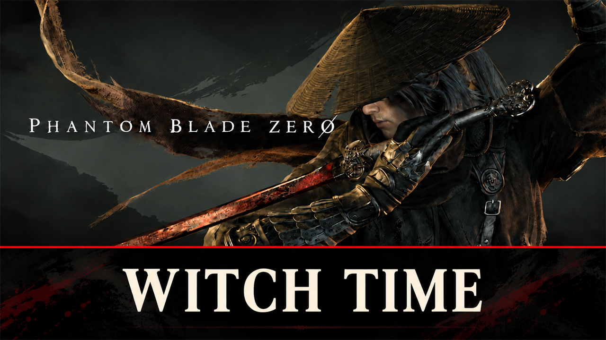

# Witch Time

Dodge through an enemy attack or parry it at the right moment, and the world slows to 30% for one second while you
keep full speed.

## What it does

Dodge or parry an enemy attack and get a moment of Witch Time:

- When your dodge makes an attack miss you, or you parry it at the right moment, the whole world slows down to 30 %
  for 1 second of real time: enemies, bosses and projectiles.
- You keep your full speed, so you can strike back (a setting turns this off; then you slow down too). The game's own
  short hit pauses on your character still work.
- Not on the red-light attacks: their perfect dodge already has the game's own slow-down and counter attack.
- A block (holding the parry button) does not count, only a parry pressed at the right moment.
- Chain them: a dodge or parry up to 2 seconds after a Witch Time ended starts a new one that lasts half as long as
  the last (1 s, 0.5 s, 0.25 s, ...). After a longer pause it is a full second again.
- A dodge or parry during a Witch Time does nothing, so it never stacks.
- Dodge and parry each have their own switch in the settings.
- No screen effect: the slow world shows itself.

It is a UE4SS script; it changes no game file. All values are settings.

## Screenshots

## How to install

1. Install UE4SS for Phantom Blade Zero, for example [UE4SS](https://github.com/KintaroModding/ue4ss) (its zip
   `phantombladezero_ue4ss_<version>.zip`: the official UE4SS build with a config that makes it run in this game).
2. Download the zip of the latest release on GitHub (`phantombladezero_witchtime_<version>.zip`).
3. Unpack it into the game folder `platform\steam\`, next to the game's exe. It adds the folder
   `ue4ss\Mods\phantombladezero_witchtime\` (with the file `enabled.txt`, UE4SS starts it by itself).
4. Start the game.

To check that it runs: `platform\steam\ue4ss\UE4SS.log` has the line `[Witch Time] <version> loaded.`

To update the mod, replace the folder with the one of the new release; to keep your settings, put your old
`Scripts\config.lua` back (a setting that it does not have keeps its default). To remove it, delete the folder
`ue4ss\Mods\phantombladezero_witchtime\`.

## How to use

Nothing to do: dodge through an enemy attack, or parry it at the right moment, and the world slows down.

## Settings

The settings are in `platform\steam\ue4ss\Mods\phantombladezero_witchtime\Scripts\config.lua`. Open it with a text editor, change
a value, save, and start the game again. `UE4SS.log` shows the settings in use in the line
`[Witch Time] Settings: ...`, and names each value it could not use.

| Setting | Default | What it does |
|---|---|---|
| `DodgeEnabled` | `true` | A dodge that makes an attack miss starts Witch Time (not the red-light perfect dodge) |
| `ParryEnabled` | `true` | A parry at the right moment starts Witch Time (not a block); both `false`: the mod does nothing |
| `WorldSpeed` | `0.3` | The world's speed during Witch Time (0.3 = 30 %; from 0.05 to 1.0) |
| `DurationSeconds` | `1.0` | Real seconds of the first Witch Time (from 0.05 to 10) |
| `ChainWindowSeconds` | `2.0` | A dodge or parry this many seconds after a Witch Time ended starts a chained one |
| `ChainFactor` | `0.5` | Each chained Witch Time lasts this times the one before (from 0 to 1) |
| `PlayerFullSpeed` | `true` | `true`: you keep full speed while the world is slow; `false`: you slow down too |
| `LogTime` | `false` | `true`: `UE4SS.log` names each dodge, parry and Witch Time (for tests and bug reports) |

## Compatibility

- Game version: Release (Steam build 26266538) (`CL-301524_JKS-17219`).
- Tested with UE4SS `v3.0.1-1183-gcdbc0b66`.
- Other mods that change the speed of the whole game work on top of it, unless they use the same time factor as this
  mod (the replay factor `DemoPlayTimeDilation`); then this mod sets its own value again during a Witch Time.

## Known issues

- Fixed in 1.8: versions up to 1.7 could crash the game now and then (their timer ran on a second thread). Please
  update to 1.8.

## How to build

There is nothing to build: `src\phantombladezero_witchtime\Scripts\main.lua` is the mod. `tests\test_main.py` runs the script
outside the game with Lua 5.4 ([lupa](https://pypi.org/project/lupa/)) and mocks of UE4SS:
`python tests\test_main.py`. `README.md` has the details.

## Credits

Made by Kintaro. MIT license: you may use, change and share this mod. UE4SS is made by the
[UE4SS-RE team](https://github.com/UE4SS-RE/RE-UE4SS). Phantom Blade Zero belongs to its makers.
